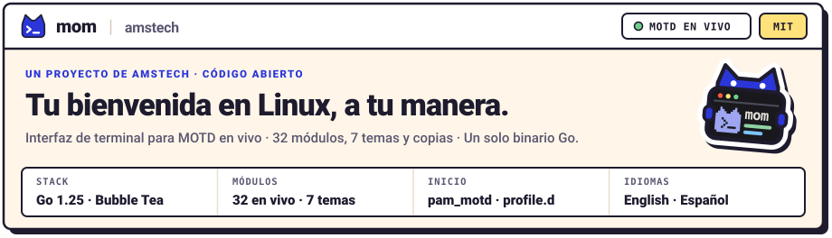
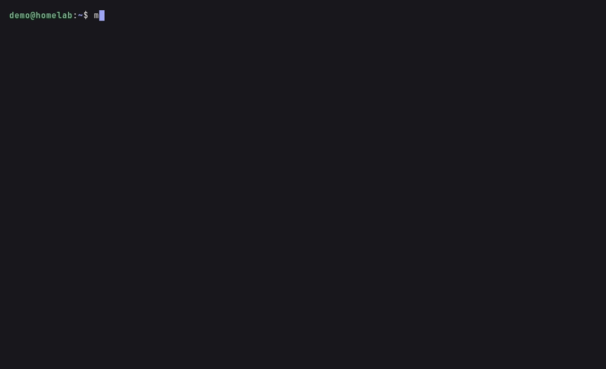
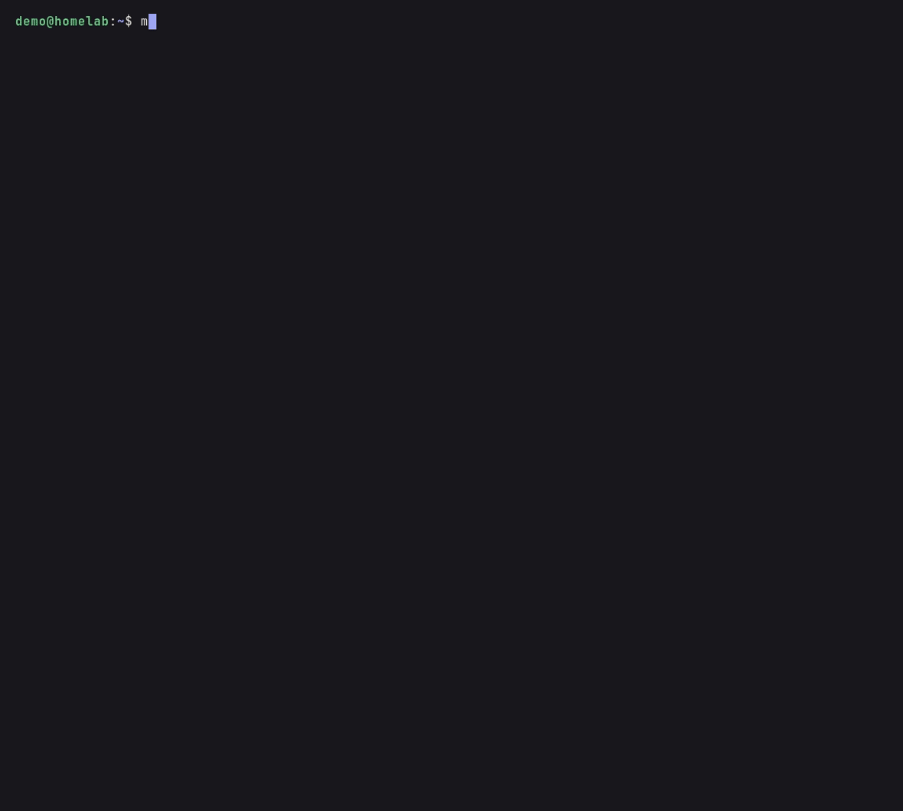

<p align="center">
  
</p>

<p align="center">
  <a href="https://github.com/msalexms/MoM/releases"></a>
  <a href="https://github.com/msalexms/MoM/actions/workflows/ci.yml"></a>
  <a href="https://go.dev"></a>
  <a href="https://github.com/msalexms/MoM"></a>
  
  <a href="LICENSE"></a>
</p>

<p align="center">
  <a href="README.md">English</a> · <strong>Español</strong>
</p>

<p align="center">
  <a href="#novedades">Novedades</a> ·
  <a href="#por-qué-mom">Por qué mom</a> ·
  <a href="#características">Características</a> ·
  <a href="#recorrido">Recorrido</a> ·
  <a href="#instalación">Instalación</a> ·
  <a href="#uso">Uso</a> ·
  <a href="#cómo-funciona">Cómo funciona</a> ·
  <a href="#módulos">Módulos</a> ·
  <a href="#temas-y-estilos">Temas</a> ·
  <a href="#configuración">Configuración</a> ·
  <a href="CHANGELOG.md">Changelog</a>
</p>

<p align="center">
  
  <br>
  <em>Elige módulos, personaliza tema y estilo, comprueba cómo quedará antes de instalar y olvídate de editar archivos a mano.</em>
</p>

---

## Novedades

**v0.2.0 — marca, bilingüe, más simple.**

- **Interfaz bilingüe** — cambia la interfaz y el MOTD entre inglés y español cuando quieras desde **Appearance → Language** (`t`), sin reiniciar.
- **Tema AMSTech por defecto** — la paleta `amstech` (índigo de marca, Thor y colores de serie) pasa a ser el séptimo tema integrado y el predeterminado en cada instalación nueva.
- **Navegación rediseñada** — menú principal agrupado con acceso directo a Módulos, Orden, Ajustes, Apariencia, Plantillas, Perfiles, Vista previa, Instalar y Copias.
- **Compilaciones versionadas** — `mom --version` muestra la versión, el commit y la fecha de compilación; GoReleaser genera los paquetes y archivos desde una etiqueta `v*`.
- **Documentación en dos idiomas** — este README, su [versión en inglés](README.md) y nuevos banners, sellos y grabaciones de marca.

<sub>Lista completa en el [changelog](CHANGELOG.md) · versiones anteriores en [GitHub](https://github.com/msalexms/MoM/releases).</sub>

---

## ¿Por qué mom?

**mom** (de **AMSTech**) es una interfaz ligera de terminal para montar tu MOTD de Linux (la pantalla de bienvenida al entrar por SSH o consola) con datos reales del equipo, sin escribir scripts frágiles ni editar `/etc/motd` a mano.

En la mayoría de servidores acabas con el texto fijo por defecto o manteniendo scripts sueltos en `/etc/update-motd.d/` que fallan entre distribuciones o bloquean el acceso SSH si un comando tarda. `mom` se compila en un único binario en Go, detecta las herramientas disponibles automáticamente, ejecuta los módulos en paralelo con un límite de 3 segundos e instala el hook adecuado para tu distribución.

- **Un solo binario estático**: hecho en Go 1.25 con Bubble Tea, sin dependencias externas en tiempo de ejecución.
- **Datos en vivo al entrar**: el MOTD se genera en cada inicio de sesión por SSH o consola, nunca congelado al instalar.
- **Seguro por diseño**: no permite abrir la TUI como root, pide `sudo` una sola vez al instalar o restaurar y respeta siempre tu `/etc/motd` original.

---

## Características

- **32 módulos con autodetección** — Sistema, CPU/RAM/discos, GPU, red, tráfico, clima, contenedores Docker/Podman, servicios y timers de systemd, pools ZFS, certificados Let's Encrypt, firewall, fail2ban, estado de git, tmux y arte ASCII. Si falta una herramienta, el módulo se atenúa y nunca rompe la salida.
- **Vista previa exacta en directo** — Comprueba en la interfaz cómo quedará el MOTD antes de instalar, salta directo a Módulos (`m`), Orden (`o`), Ajustes (`c`) o Apariencia (`t`) y vuelve con la vista previa regenerada.
- **7 temas y 6 estilos** — Incluye el tema **AMSTech** (`amstech`) por defecto (índigo de marca, Thor y colores de serie), junto a `default` (16 colores clásicos), `dracula`, `nord`, `solarized-dark`, `monochrome`, `ascii`, temas propios en TOML y 6 estilos de sección.
- **10 plantillas y perfiles guardados** — Parte de configuraciones listas (`minimal`, `sysadmin`, `developer`, `hacker`, `full`, `aesthetic`, `security`, `homelab`, `gaming`, `server`) o guarda y recupera tus ajustes completos como perfiles.
- **Bilingüe (`EN / ES`)** — En inglés por defecto; cambia a **Español** al instante desde **Appearance → Language**.
- **Copias con vista previa y desinstalación limpia** — Conserva intacto el `/etc/motd` original más las últimas 30 instalaciones en `~/.config/mom/backups/`, permite previsualizar y reinstalar cualquiera y se desinstala limpiamente con `mom --uninstall`.

---

## Recorrido

Cada pantalla de la interfaz en acción:

<details>
<summary><strong>Módulos</strong> — búsqueda con <code>/</code>, aviso de permisos root, ayuda por módulo y activar/desactivar todos</summary>


</details>

<details>
<summary><strong>Ajustes de módulos</strong> — ciudad y unidades del clima, selector de servicios systemd, rutas de git y arte ASCII</summary>


</details>

<details>
<summary><strong>Apariencia</strong> — cambio de idioma en directo, muestra en vivo de temas y estilos de sección</summary>


</details>

<details>
<summary><strong>Plantillas y perfiles</strong> — aplicar una plantilla, guardarla como perfil y volver a cargarla</summary>



</details>

<details>
<summary><strong>Vista previa</strong> — desplazarse por el MOTD, saltar a editar y volver con la vista regenerada</summary>


</details>

<details>
<summary><strong>Instalar e iniciar sesión</strong> — se instala una vez; cada login por SSH genera datos nuevos al momento (fíjate en la cita)</summary>



</details>

<details>
<summary><strong>Copias de seguridad</strong> — previsualizar cada instalación guardada y restaurar una anterior</summary>


</details>

---

## Instalación

```bash
# Binario (amd64; cambia a arm64 o armv7 según tu máquina)
curl -sL https://github.com/msalexms/MoM/releases/latest/download/mom_linux_amd64.tar.gz | tar xz
sudo install -m755 mom /usr/local/bin/mom

# Paquetes .deb / .rpm (en la página de releases)
sudo dpkg -i mom_*_amd64.deb   # Debian, Ubuntu
sudo rpm -i mom_*_amd64.rpm    # Fedora, RHEL

# Desde el código fuente (Go 1.25+)
git clone https://github.com/msalexms/MoM.git && cd MoM && make build
```

> [!NOTE]
> Ejecuta `mom` siempre con tu usuario normal, nunca con `sudo`. La interfaz rechaza abrirse como root y pide la contraseña de `sudo` una sola vez al instalar o restaurar el script de inicio de sesión.

---

## Uso

```bash
mom            # abre la interfaz interactiva
```

La interfaz y el MOTD salen en **inglés** por defecto. Para pasarlos a español ve a **Appearance → Language → Español** (`t` desde el menú principal): la interfaz cambia al instante y el MOTD instalado se actualiza la próxima vez que pulses `s`.

Desde el menú principal puedes saltar directamente con una tecla: `m` Módulos, `o` Orden, `c` Ajustes, `t` Apariencia, `p` Plantillas, `f` Perfiles, `v` Vista previa, `s` Instalar y `b` Copias de seguridad.

| Tecla | Acción |
| --- | --- |
| `↑` `↓` · `j` `k` | Mover el cursor |
| `Enter` | Abrir, elegir o editar un valor |
| `Espacio` | Activar o desactivar elemento |
| `/` | En Módulos: búsqueda en directo |
| `a` · `d` | En Módulos: activar todos los disponibles · desactivar todos |
| `Mayús`+`↑` `↓` · `K` `J` | En Orden: subir o bajar módulo |
| `a` · `x` | En editores de lista (rutas git): añadir · quitar entrada |
| `d` | En Perfiles: pulsar dos veces para borrar un perfil |
| `m` `o` `c` `t` · `r` | En Vista previa: saltar a Módulos, Orden, Ajustes o Apariencia y volver · regenerar |
| `s` | Generar e instalar el MOTD |
| `?` | Ayuda; en Módulos, ver detalles del módulo seleccionado |
| `Esc` | Volver o cancelar |
| `q` | Salir (avisa si hay cambios sin instalar) |

### Sin interfaz

```bash
mom --print                    # imprime el MOTD con tu configuración sin instalar nada
mom --apply                    # instala el MOTD con tu configuración
mom --full-auto                # activa todos los módulos disponibles e instala
mom --apply-template sysadmin  # aplica una plantilla integrada e instala
mom --export-template mi.toml  # exporta tu configuración como plantilla
mom --import-template mi.toml  # aplica una plantilla desde archivo e instala
mom --uninstall                # quita mom del inicio de sesión y restaura el MOTD original
mom --version                  # muestra versión, commit y fecha de compilación
```

---

## Cómo funciona

Al instalar, `mom` guarda tu configuración en `/etc/mom/config.toml` y crea un pequeño script de inicio de sesión que ejecuta `mom --motd`, de modo que cada acceso muestra datos reales del momento:

| Distribución | Script | Cómo se ejecuta |
| --- | --- | --- |
| Debian, Ubuntu y derivadas | `/etc/update-motd.d/99-mom` | En cada login mediante `pam_motd` (como root) |
| Fedora/RHEL, Arch, openSUSE y el resto | `/etc/profile.d/mom-motd.sh` | En cada shell de login interactiva (como tu usuario) |

- **Solo al iniciar sesión**: aparece al entrar por SSH o consola, nunca al abrir pestañas nuevas ni subshells.
- **Límite de 3 segundos**: los módulos corren en paralelo y cualquier comprobación lenta (red, gestor de paquetes) se omite en ese login.
- **`/etc/motd` queda intacto**: `mom` nunca sobrescribe `/etc/motd` (y restaura el original si una versión anterior lo modificó).
- **Historial de copias**: cada instalación se guarda en `~/.config/mom/backups/` (hasta las últimas 30 copias más el `/etc/motd` original inmutable).
- **Desinstalación limpia**: `mom --uninstall` elimina el script, borra `/etc/mom/config.toml` y restaura el `/etc/motd` original.

---

## Módulos

<details>
<summary><strong>Los 32 módulos</strong></summary>

| Módulo | Muestra | Necesita |
| --- | --- | --- |
| `logo` | Logo ASCII de la distribución | — (usa `fastfetch` si está) |
| `system` | Equipo, kernel, tiempo encendido, shell y usuario | — |
| `resources` | Carga de CPU, memoria, swap y discos | — |
| `gpu` | Modelo, uso, VRAM y temperatura | `nvidia-smi` o GPU AMD |
| `network` | Direcciones IP local y pública | — |
| `traffic` | Bytes enviados y recibidos por interfaz | — |
| `weather` | Clima actual (`wttr.in`) | Conexión a internet |
| `containers` | Contenedores en ejecución | `docker` o `podman` |
| `services` | Estado de servicios de systemd | `systemctl` |
| `ports` | Puertos TCP en escucha | `ss` |
| `procs` | Procesos que más memoria consumen | — |
| `diskio` | Lecturas, escrituras y tiempo de E/S por disco | — |
| `timers` | Próximos timers programados de systemd | `systemctl` |
| `journal` | Errores recientes del journal (últimas 24 h) | `journalctl` · **root** |
| `zfs` | Salud y uso de pools ZFS | `zpool` |
| `certs` | Días restantes de certificados Let's Encrypt | `/etc/letsencrypt/live` |
| `firewall` | Reglas activas del firewall (`ufw` o `nftables`) | `ufw` o `nft` · **root** |
| `fail2ban` | Jaulas activas e IP bloqueadas | `fail2ban-client` · **root** |
| `failed-logins` | Intentos SSH fallidos en las últimas 24 h | `journalctl` · **root** |
| `sudo` | Últimos comandos con sudo en auth log | `/var/log/auth.log` · **root** |
| `battery` | Nivel y estado de carga de la batería | `/sys/class/power_supply` |
| `users` | Usuarios conectados y su TTY | — |
| `sshkeys` | Agente SSH y claves autorizadas | — |
| `boot` | Último arranque y antigüedad del sistema | — |
| `git` | Repositorios con cambios sin confirmar | `git` |
| `tmux` | Sesiones activas de tmux | `tmux` |
| `reboot` | Aviso de reinicio pendiente | — |
| `updates` | Paquetes pendientes de actualizar | `apt`, `dnf`, `pacman` o `zypper` |
| `logins` | Últimos accesos y sesiones SSH activas | `last` |
| `calendar` | Calendario del mes actual | `cal` |
| `quote` | Cita aleatoria de programación | — |
| `cowsay` | Texto propio en arte ASCII, cowsay o figlet | Según el modo |

Los módulos marcados con **root** leen registros o estado del firewall reservados a root. En Debian y Ubuntu el hook `pam_motd` se ejecuta como root así que funcionan solos; en el resto se ejecuta como tu usuario y se omiten salvo que pueda leer esos datos. La interfaz los marca con la etiqueta `root`.

</details>

Los módulos configurables (`weather`, `cowsay`, `resources`, `containers`, `updates`, `git` y `services`) tienen sus opciones en **Ajustes de módulos** (`c`).

---

## Temas y estilos

| Tema | Paleta |
| --- | --- |
| `amstech` | Paleta de **AMSTech**: índigo, Thor y colores de serie *(por defecto)* |
| `default` | 16 colores ANSI vivos; funciona en cualquier terminal |
| `dracula` | Paleta truecolor rosa y morado |
| `nord` | Tonos árticos azules |
| `solarized-dark` | Variante oscura clásica de Solarized |
| `monochrome` | Sin color: solo negrita y atenuado |
| `ascii` | Texto plano sin colores ni Unicode |

Para añadir temas propios, guarda archivos `.toml` dentro de `~/.config/mom/themes/`.

| Estilo | Diseño |
| --- | --- |
| `default` | Título de sección con línea horizontal y pares clave/valor |
| `compact` | Una línea compacta por módulo |
| `boxed` | Cajas Unicode con esquinas redondeadas |
| `powerline` | Bloques estilo powerline con flechas |
| `cards` | Tarjetas con borde doble y sombra |
| `minimal` | Solo datos con cabecera mínima |

---

## Plantillas

Plantillas integradas: `minimal`, `sysadmin`, `developer`, `hacker`, `full`, `aesthetic`, `security`, `homelab`, `gaming` y `server`. Una plantilla solo decide qué módulos están activos: nunca sobrescribe tus ajustes, tema ni estilo.

---

## Configuración

Se guarda en `~/.config/mom/config.toml` al instalar desde la interfaz, aunque también puedes editarla a mano:

```toml
[mode]
language = "es"   # en (por defecto) | es
theme = "amstech"
variant = "default"
module_order = ["logo", "system", "resources", "network", "weather"]

[modules]
logo = true
system = true
resources = true
weather = true

[modules.weather_config]
city = "Madrid"
units = "metric"

[modules.cowsay_config]
mode = "ascii-art"
message = "Hola"
```

---

## Desarrollo

```bash
make build      # compila bin/mom para linux/amd64
make build-all  # compila amd64, arm64 y armv7 con checksums
make test       # ejecuta los tests con -race
make lint       # ejecuta go vet y staticcheck
make fmt        # formatea el código con gofmt
make run        # ejecuta en local con go run
```

| Paquete / Recurso | Función |
| --- | --- |
| `cmd/mom` | Punto de entrada CLI, flags sin interfaz y hook de login (`--motd`) |
| `internal/module` | Los 32 módulos, comprobación de dependencias e interfaces `ConfigSync` y `Privileged` |
| `internal/module/render` | Estilos de sección (`default`, `compact`, `boxed`, `powerline`, `cards`, `minimal`) |
| `internal/theme` | Paletas integradas (`amstech` + 6 más) y cargador de temas TOML |
| `internal/i18n` | Traducciones inglés y español |
| `internal/generator` | Generación concurrente del MOTD e instalación de `/etc/mom/config.toml` y hooks |
| `internal/backup` | Copia inmutable del `/etc/motd` original e historial de 30 instantáneas |
| `internal/config` y `internal/template` | Configuración TOML, perfiles y 10 plantillas embebidas |
| `internal/tui` | Pantallas en Bubble Tea y componentes de marca AMSTech en terminal |
| `assets/brand/` y `assets/banner*.svg` | Pegatina Thor Terminal y banners y sellos de marca AMSTech |

### Versiones

Las versiones siguen el [Versionado Semántico](https://semver.org/lang/es/) y se publican desde una etiqueta `v*`. Al subir la etiqueta se ejecuta [release.yml](.github/workflows/release.yml), que compila los archivos para amd64, arm64 y armv7, además de los paquetes `.deb` y `.rpm` con GoReleaser, genera los checksums y publica las notas. La lista de comprobación está en [docs/RELEASING.md](docs/RELEASING.md).

---

## Licencia

Copyright (c) 2026 Alejandro Martín (AMSTech). Publicado bajo la [Licencia MIT](LICENSE).

---

<p align="center">
  <picture>
    <source media="(prefers-color-scheme: dark)" srcset="assets/brand/seal-es-dark.svg">
    
  </picture>
</p>

<p align="center">
  <strong>Un proyecto de AMSTech</strong> · Hecho para mí, compartido con todos · <a href="https://amstech.dev">amstech.dev</a>
  <br>
  <a href="LICENSE">MIT</a> © 2026 Alejandro Martín (AMSTech) · <a href="CHANGELOG.md">Changelog</a>
</p>
