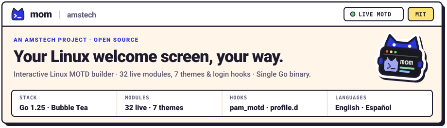
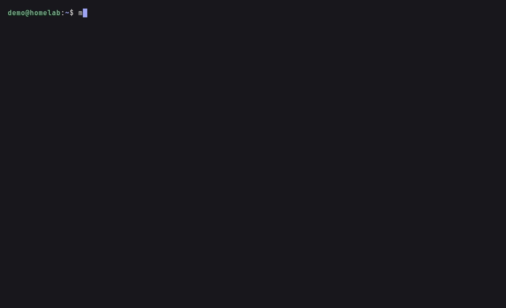
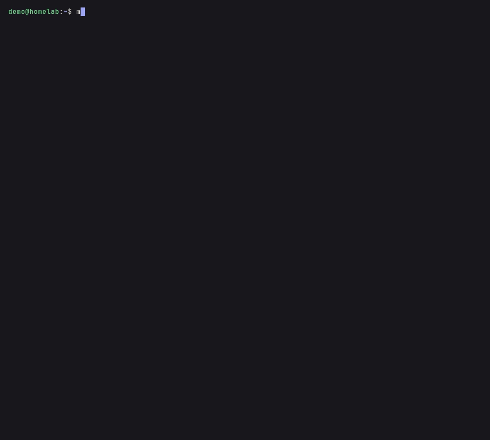

<p align="center">
  
</p>

<p align="center">
  <a href="https://github.com/msalexms/MoM/releases"></a>
  <a href="https://github.com/msalexms/MoM/actions/workflows/ci.yml"></a>
  <a href="https://go.dev"></a>
  <a href="https://github.com/msalexms/MoM"></a>
  
  <a href="LICENSE"></a>
</p>

<p align="center">
  <strong>English</strong> · <a href="README.es.md">Español</a>
</p>

<p align="center">
  <a href="#whats-new">What's new</a> ·
  <a href="#why-mom">Why mom?</a> ·
  <a href="#features">Features</a> ·
  <a href="#tour">Tour</a> ·
  <a href="#install">Install</a> ·
  <a href="#usage">Usage</a> ·
  <a href="#how-it-works">How it works</a> ·
  <a href="#modules">Modules</a> ·
  <a href="#themes-and-styles">Themes</a> ·
  <a href="#configuration">Config</a> ·
  <a href="CHANGELOG.md">Changelog</a>
</p>

<p align="center">
  
  <br>
  <em>Pick modules, customize themes and styles, preview the exact login screen, and install with zero hand-edited scripts.</em>
</p>

---

## What's new

**v0.2.0 — brand, bilingual, streamlined.**

- **Bilingual interface** — switch the TUI and the MOTD between English and Spanish at any time under **Appearance → Language**, with no restart.
- **AMSTech theme by default** — the `amstech` palette (brand indigo, Thor, and series colors) becomes the seventh built-in theme and the default for every new install.
- **Redesigned navigation** — a grouped home screen with one-key access to Modules, Order, Settings, Appearance, Templates, Profiles, Preview, Install, and Backups.
- **Versioned builds** — `mom --version` prints the release, commit, and build date; packages and archives are produced from a `v*` tag by GoReleaser.
- **Documentation in two languages** — this README, its [Spanish counterpart](README.es.md), and new brand banners, seals, and screen recordings.

<sub>Full details in the [changelog](CHANGELOG.md) · older releases on [GitHub](https://github.com/msalexms/MoM/releases).</sub>

---

## Why mom?

**mom** (by **AMSTech**) is a lightweight terminal interface to build your Linux MOTD (Message Of the Day) out of live data from your machine — without writing fragile shell scripts or hand-editing `/etc/motd`.

Most servers either leave the default distro banner untouched or rely on cobbled-together `/etc/update-motd.d/` snippets that break across distributions or stall SSH logins when a command hangs. `mom` compiles to a single static Go binary, detects available tools automatically, renders modules in parallel within a strict 3-second budget, and installs clean distro-appropriate login hooks.

- **Single static binary**: built with Go 1.25 and Bubble Tea — no runtime dependencies.
- **Live at every login**: data is generated when you log in via SSH or console, never frozen at install time.
- **Safe by design**: refuses to run the TUI as root, only requests `sudo` when writing the system config and hook, and preserves your original `/etc/motd`.

---

## Features

- **32 Auto-Detecting Modules** — System, CPU/RAM/disk, GPU, network, traffic, weather, Docker/Podman containers, systemd services & timers, ZFS pools, Let's Encrypt certificates, firewall, fail2ban, git status, tmux, and ASCII art. Missing tools dim in the list and never break the MOTD.
- **Exact Live Preview** — Inspect your MOTD inside the TUI before installing, jump straight to Modules (`m`), Order (`o`), Settings (`c`), or Appearance (`t`), and return to a freshly rendered preview.
- **7 Themes & 6 Styles** — Ships with the **AMSTech** (`amstech`) theme by default (brand indigo, Thor, and series colors), alongside `default` (Classic 16-color), `dracula`, `nord`, `solarized-dark`, `monochrome`, `ascii`, custom TOML themes, and 6 section layouts.
- **10 Templates & Saved Profiles** — Apply presets (`minimal`, `sysadmin`, `developer`, `hacker`, `full`, `aesthetic`, `security`, `homelab`, `gaming`, `server`) or save and restore full configurations as named profiles.
- **Bilingual (`EN / ES`)** — English by default and switchable live to **Español** under **Appearance → Language**.
- **Backups with Preview & Clean Uninstall** — Keeps the immutable original `/etc/motd` plus the last 30 installs in `~/.config/mom/backups/`, lets you preview and reinstall any snapshot, and cleanly removes itself with `mom --uninstall`.

---

## Tour

Each screen of the interface in action:

<details>
<summary><strong>Modules</strong> — search with <code>/</code>, root-only indicators, module help, and batch toggles</summary>


</details>

<details>
<summary><strong>Module settings</strong> — weather city and units, systemd service picker, git paths, ASCII art text</summary>


</details>

<details>
<summary><strong>Appearance</strong> — switch language live, preview themes and section styles side by side</summary>


</details>

<details>
<summary><strong>Templates and profiles</strong> — apply a template, save it as a profile, and load it back</summary>



</details>

<details>
<summary><strong>Preview</strong> — scroll the output, jump to edit a screen, and come back to a fresh preview</summary>


</details>

<details>
<summary><strong>Install and SSH login</strong> — install once; every SSH login renders fresh live data (watch the quote change)</summary>



</details>

<details>
<summary><strong>Backups</strong> — preview each saved install and restore any previous setup</summary>


</details>

---

## Install

```bash
# Binary (amd64; swap for arm64 or armv7 to match your machine)
curl -sL https://github.com/msalexms/MoM/releases/latest/download/mom_linux_amd64.tar.gz | tar xz
sudo install -m755 mom /usr/local/bin/mom

# .deb / .rpm packages (from the releases page)
sudo dpkg -i mom_*_amd64.deb   # Debian, Ubuntu
sudo rpm -i mom_*_amd64.rpm    # Fedora, RHEL

# From source (Go 1.25+)
git clone https://github.com/msalexms/MoM.git && cd MoM && make build
```

> [!NOTE]
> Always run `mom` as your regular user, not with `sudo`. The TUI refuses to start as root and prompts for `sudo` once only when installing or restoring the login hook.

---

## Usage

```bash
mom            # open the interactive interface
```

The interface and MOTD default to **English**. Switch to Spanish anytime via **Appearance → Language → Español** (`t` from the home menu): the TUI switches immediately, and the installed MOTD updates on your next install (`s`).

From the home menu you can jump directly with a shortcut key: `m` Modules, `o` Order, `c` Module settings, `t` Appearance, `p` Templates, `f` Profiles, `v` Preview, `s` Install, and `b` Backups.

| Key | Action |
| --- | --- |
| `↑` `↓` · `j` `k` | Move cursor |
| `Enter` | Open, choose, or edit a value |
| `Space` | Toggle item on/off |
| `/` | In Modules: live search |
| `a` · `d` | In Modules: enable all available · disable all |
| `Shift`+`↑` `↓` · `K` `J` | In Order: move module up/down |
| `a` · `x` | In list editors (git paths): add · remove entry |
| `d` | In Profiles: press twice to delete a saved profile |
| `m` `o` `c` `t` · `r` | In Preview: jump to Modules, Order, Settings, or Appearance and return · refresh |
| `s` | Generate and install the MOTD |
| `?` | Help; in Modules, show details for the highlighted module |
| `Esc` | Back or cancel |
| `q` | Quit (prompts if there are uninstalled changes) |

### Without the interface

```bash
mom --print                    # print the MOTD with your config without installing
mom --apply                    # install the MOTD with your config
mom --full-auto                # enable every available module and install
mom --apply-template sysadmin  # apply a built-in template and install
mom --export-template my.toml  # export your config as a template
mom --import-template my.toml  # apply a template file and install
mom --uninstall                # remove mom from login and restore the original MOTD
mom --version                  # print version, commit, and build date
```

---

## How it works

Installing copies your configuration to `/etc/mom/config.toml` and installs a login hook that runs `mom --motd`, so every login renders fresh live telemetry:

| Distribution | Hook | Execution context |
| --- | --- | --- |
| Debian, Ubuntu, and derivatives | `/etc/update-motd.d/99-mom` | At every login via `pam_motd` (runs as root) |
| Fedora/RHEL, Arch, openSUSE, and others | `/etc/profile.d/mom-motd.sh` | In interactive login shells (runs as your user) |

- **Login-only**: runs on SSH or console login, never inside subshells or new terminal tabs.
- **3-second ceiling**: modules run concurrently and any check that times out (network, package manager) is skipped for that login.
- **`/etc/motd` stays intact**: `mom` never overwrites `/etc/motd` (and restores the original if an earlier version replaced it).
- **Backup history**: every install is saved to `~/.config/mom/backups/` (up to the last 30 snapshots plus the immutable original `/etc/motd`).
- **Clean removal**: `mom --uninstall` removes the hook, removes `/etc/mom/config.toml`, and restores the original `/etc/motd`.

---

## Modules

<details>
<summary><strong>All 32 modules</strong></summary>

| Module | Shows | Needs |
| --- | --- | --- |
| `logo` | ASCII logo of the distribution | — (uses `fastfetch` when present) |
| `system` | Host, kernel, uptime, shell, and user | — |
| `resources` | CPU load, memory, swap, and disks | — |
| `gpu` | Model, usage, VRAM, and temperature | `nvidia-smi` or an AMD GPU |
| `network` | Private and public IP addresses | — |
| `traffic` | Bytes received and sent per interface | — |
| `weather` | Current weather (`wttr.in`) | Internet access |
| `containers` | Running containers | `docker` or `podman` |
| `services` | Status of systemd services | `systemctl` |
| `ports` | Listening TCP ports | `ss` |
| `procs` | Top memory-consuming processes | — |
| `diskio` | Reads, writes, and I/O time per disk | — |
| `timers` | Next scheduled systemd timers | `systemctl` |
| `journal` | Error-level journal entries (last 24 h) | `journalctl` · **root** |
| `zfs` | ZFS pool health and usage | `zpool` |
| `certs` | Days remaining on Let's Encrypt certificates | `/etc/letsencrypt/live` |
| `firewall` | Active firewall rules (`ufw` or `nftables`) | `ufw` or `nft` · **root** |
| `fail2ban` | Active jails and banned IPs | `fail2ban-client` · **root** |
| `failed-logins` | Failed SSH attempts in the last 24 h | `journalctl` · **root** |
| `sudo` | Recent sudo commands from auth log | `/var/log/auth.log` · **root** |
| `battery` | Battery level and charging state | `/sys/class/power_supply` |
| `users` | Logged-in users and their TTY | — |
| `sshkeys` | SSH agent status and authorized keys | — |
| `boot` | Last boot time and install age | — |
| `git` | Repositories with uncommitted changes | `git` |
| `tmux` | Active tmux sessions | `tmux` |
| `reboot` | Pending reboot notice | — |
| `updates` | Packages waiting to be updated | `apt`, `dnf`, `pacman`, or `zypper` |
| `logins` | Recent logins and active SSH sessions | `last` |
| `calendar` | Current month's calendar | `cal` |
| `quote` | Random programming quote | — |
| `cowsay` | Custom text as ASCII art, cowsay, or figlet | Depends on mode |

Modules marked **root** read privileged system logs or firewall state. On Debian/Ubuntu the `pam_motd` hook runs as root so they render automatically; on other families the hook runs as your user and skips them unless that user has read access. The TUI marks them with a `root` tag.

</details>

Configurable modules (`weather`, `cowsay`, `resources`, `containers`, `updates`, `git`, and `services`) expose their options under **Module settings** (`c`).

---

## Themes and styles

| Theme | Palette |
| --- | --- |
| `amstech` | **AMSTech** brand palette: indigo, Thor, and series colors *(default)* |
| `default` | Classic bright 16-color ANSI; works in any terminal |
| `dracula` | Vivid pink and purple truecolor palette |
| `nord` | Cold arctic blues |
| `solarized-dark` | Canonical Solarized Dark palette |
| `monochrome` | Bold and dim attributes only (no color) |
| `ascii` | Plain text with no colors or Unicode |

Drop custom `.toml` themes into `~/.config/mom/themes/` to add your own palettes.

| Style | Layout |
| --- | --- |
| `default` | Section title with a horizontal rule and key/value pairs |
| `compact` | One dense line per module |
| `boxed` | Rounded Unicode box frames |
| `powerline` | Powerline blocks with arrows |
| `cards` | Double-border cards with drop shadow |
| `minimal` | Bare data with minimal headers |

---

## Templates

Built-in templates: `minimal`, `sysadmin`, `developer`, `hacker`, `full`, `aesthetic`, `security`, `homelab`, `gaming`, and `server`. Templates only toggle which modules are enabled — they never overwrite your module settings, theme, or style.

---

## Configuration

Saved to `~/.config/mom/config.toml` when you install from the interface, or editable directly:

```toml
[mode]
language = "en"   # en (default) | es
theme = "amstech"
variant = "default"
module_order = ["logo", "system", "resources", "network", "weather"]

[modules]
logo = true
system = true
resources = true
weather = true

[modules.weather_config]
city = "Madrid"
units = "metric"

[modules.cowsay_config]
mode = "ascii-art"
message = "Hello"
```

---

## Development

```bash
make build      # compile bin/mom for linux/amd64
make build-all  # compile amd64, arm64, and armv7 with checksums
make test       # run test suite with -race
make lint       # run go vet and staticcheck
make fmt        # format code with gofmt
make run        # run locally with go run
```

| Package / Asset | Responsibility |
| --- | --- |
| `cmd/mom` | CLI entrypoint, headless flags, login hook (`--motd`) |
| `internal/module` | 32 MOTD modules, dependency checks, `ConfigSync` & `Privileged` interfaces |
| `internal/module/render` | Section layouts (`default`, `compact`, `boxed`, `powerline`, `cards`, `minimal`) |
| `internal/theme` | Built-in palettes (`amstech` + 6 others) and custom TOML theme loader |
| `internal/i18n` | English and Spanish translations |
| `internal/generator` | Concurrent MOTD generation, `/etc/mom/config.toml` and login hook installation |
| `internal/backup` | Immutable original `/etc/motd` + 30-snapshot history |
| `internal/config` & `internal/template` | TOML config, profiles, and 10 embedded templates |
| `internal/tui` | Bubble Tea TUI screens and AMSTech terminal brand components |
| `assets/brand/` & `assets/banner*.svg` | Thor Terminal sticker and AMSTech brand banners & seals |

### Releases

Releases follow [Semantic Versioning](https://semver.org/) and are cut from a `v*` tag. Pushing the tag runs [release.yml](.github/workflows/release.yml), which builds the amd64, arm64, and armv7 archives plus the `.deb` and `.rpm` packages with GoReleaser, writes the checksums, and publishes the notes. The full checklist is in [docs/RELEASING.md](docs/RELEASING.md).

---

## License

Copyright (c) 2026 Alejandro Martín (AMSTech). Released under the [MIT License](LICENSE).

---

<p align="center">
  <picture>
    <source media="(prefers-color-scheme: dark)" srcset="assets/brand/seal-en-dark.svg">
    
  </picture>
</p>

<p align="center">
  <strong>An AMSTech project</strong> · Built for me, shared with all · <a href="https://amstech.dev">amstech.dev</a>
  <br>
  <a href="LICENSE">MIT</a> © 2026 Alejandro Martín (AMSTech) · <a href="CHANGELOG.md">Changelog</a>
</p>
